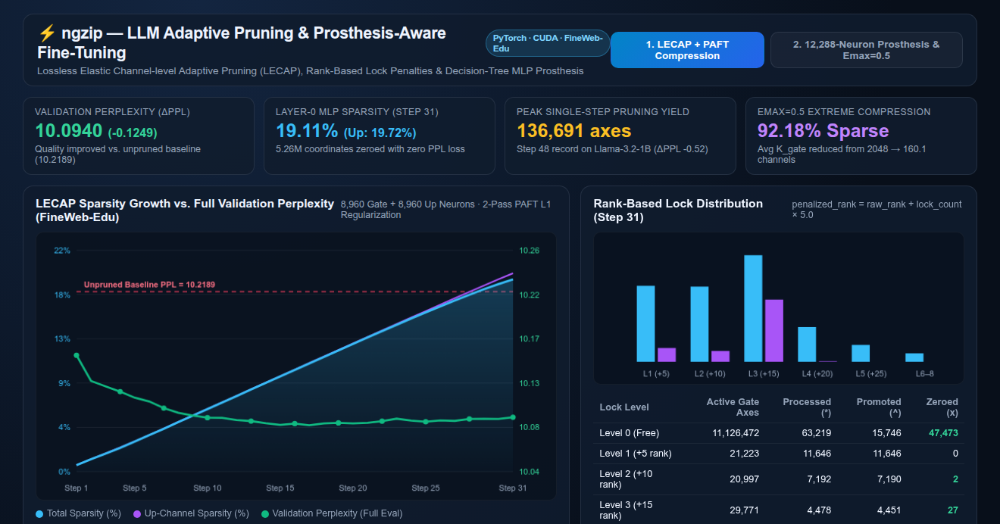
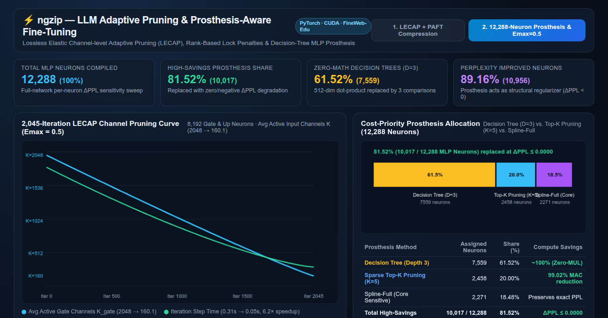

# ⚡ ngzip — LLM Adaptive Pruning & Prosthesis-Aware Fine-Tuning (PyTorch / CUDA)

**`ngzip`** is an experimental PyTorch & CUDA framework for **fine-grained structural MLP compression and non-parametric neuron prosthesis** in Large Language Models (`Llama-3.2-1B` SwiGLU layers and `TinyStories-33M`).

Instead of uniform magnitude pruning or coarse post-training quantization, `ngzip` treats each MLP neuron's input channels and activation surface individually through two complementary pipelines:
1. **LECAP + PAFT (Lossless Elastic Channel-level Adaptive Pruning with Prosthesis-Aware Fine-Tuning):** Dynamic per-neuron active channel allocation (`K_gate`, `K_up`) with **Rank-Based Lock Penalties** and **2-Pass PAFT** (Phase A: pure cross-entropy weight recovery; Phase B: targeted L1 regularization on candidate tail channels).
2. **Cost-Priority Neuron Prosthesis:** Full-network per-neuron sensitivity profiling (`12,288` MLP neurons) replacing insensitive dot-products with **Depth-3 Decision Trees** (`0` multiplications — 3 scalar threshold comparisons) or **Top-K Sparse Projections (`K=5`)**.

---

## 📊 Interactive Benchmark Dashboard & Screenshots

👉 **[Open Interactive Benchmark Explorer (`https://aminadav-ai.github.io/ngzip-llm/`)](https://aminadav-ai.github.io/ngzip-llm/)**

### 1. LECAP Sparsity Growth vs. Full Validation Perplexity (`Llama-3.2-1B`, FineWeb-Edu)

### 2. Full-Network 12,288-Neuron Prosthesis & Extreme Channel Compression (`Emax = 0.5`)

---

## 🔬 Key Empirical Results

| Experiment / Pipeline | Target Architecture | Sparsity / Compute Savings | Perplexity Impact ($\Delta\text{PPL}$) |
| :--- | :--- | :--- | :--- |
| **LECAP + 2-Pass PAFT (Strict Lossless)** | `Llama-3.2-1B` Layer-0 SwiGLU (`8,960` Gate + `8,960` Up neurons) | **19.11% total sparsity** (`5.26M` zeroed coordinates; peak **136,691 axes** pruned in 1 step) | **10.2189 → 10.0940** ($\Delta\text{PPL} = -0.1249$, quality improved) |
| **LECAP Relaxed Threshold (`Emax = 0.5`)** | `8,192` Gate & Up MLP Neurons (`2,045` iterations) | **92.18% Gate / 91.71% Up sparsity** (`Avg K_gate: 2048 → 160.1`), **6.2× faster step time** (`0.31s → 0.05s`) | Bounded per-step perplexity budget |
| **Full-Network Neuron Prosthesis** | `12,288` MLP Neurons across all layers | **81.52% (`10,017` neurons)** replaced by **Depth-3 Decision Trees (`61.52%`)** + **Top-K Pruning (`20.00%`)** | **Zero degradation** ($\Delta\text{PPL} \le 0.0000$; `89.16%` of neurons improved PPL) |

---

## 🧩 Repository Structure

* [`llama_lecap_mlp.py`](llama_lecap_mlp.py) — Vectorized PyTorch implementation of **LECAP** for `Llama-3.2-1B` SwiGLU MLP layers (`gate_proj`, `up_proj`, `down_proj`), including rank-based lock levels (`penalized_rank = raw_rank + lock_count * 5.0`), dynamic `K_gate` / `K_up` buffers, and targeted tail-channel L1 regularization.
* [`llama_pwl_mlp.py`](llama_pwl_mlp.py) — **Piecewise-Linear (PWL) & Dual-Tree MLP** module supporting vectorized depth-3 decision trees and spline activations on GPU.
* [`llama_vectorized_mlp.py`](llama_vectorized_mlp.py) — Compiled GPU execution engine partitioning each layer's MLP into `Tree-3` (zero-multiplication index lookup), `Sparse Top-K`, and `Core Full-Precision` neuron groups.
* [`full_net_report.md`](full_net_report.md) — Detailed breakdown of the 12,288-neuron full-network prosthesis sweep.
